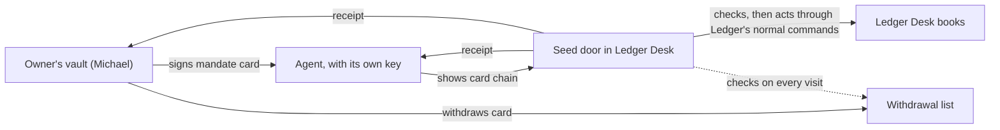

# Seed Vault: overview

08-11-2026 · Michael (with Claude)

A personal vault for one holder, a person or an agent. It hands out signed **cards** instead of raw data, so any organisation can check who someone is and what they may do, without ever owning their information. Seed Vault is its own open-source product (Apache 2.0). It plugs into Ledger Desk, and into any other receiver, only through the open card format and one handshake. No shared database, no shared login.

**Where we are today:** Slice 1, *agent mandate cards*, is **built and tested, not running for real**. An owner can sign a card that says what one of their agents may do, a receiver checks it, both sides keep a receipt, and the owner can pull the card back. All 17 shared test cases pass, both in Seed Vault and in Ledger Desk's door. Keys are still software keys, so nothing here is safe to use with real money or real clients yet.

## Status at a glance

| | State | What I checked |
| --- | --- | --- |
| **Designed** | Yes, the whole vault | Design docs of 01-11 and 07-11-2026 in the project files |
| **Built** | Slice 1 only: the agent mandate cards | seed-vault draft PR #1 (24 files) and ledger-desk-ecosystem draft PR #3 |
| **Tested** | 17 of 17 shared cases pass, in both projects | Automatic checks (CI, the robot that reruns the tests on every change) are green on both PRs as of 08-11-2026 |
| **Running for real** | **No** | Software keys only, withdrawal list not published anywhere, no web route into Ledger Desk |
| **Proven with a real agent** | **No** | Needs an agent key in the Mac mini's security chip and a live door in Ledger Desk |

Both PRs are still drafts, so none of this is in the main version of either project yet.

## The idea in three rules

1. **Theirs, always.** The vault belongs to the holder, never to an office or ecosystem. Ledger Desk is a guest. When someone leaves a firm, they withdraw their cards and walk out with everything.
2. **Share proofs, not raw data.** Prove "over 18" without a birth date. Prove "this agent acts for Michael" without handing over a key.
3. **Every share leaves a receipt.** Who got what, for what purpose, until when. Both sides keep a copy, and any card can be pulled back.

## What it does

- **Cards:** small, tamper-proof statements signed by someone who vouches for them, such as "identity verified by the Dutch government" or "this agent may draft invoices for Michael until 30-04-2027". Every card has an issuer, a subject, a start and end date, and a pointer to a withdrawal list. *Designed for all drawers; built for agent cards.*
- **Agent mandates:** an owner signs a mandate card for one agent: what it may do, what it may never do, its limits (for example at most 20 drafts a day, nothing above 5,000 euro), its purpose and its expiry. A mandate can only narrow rights, never widen them. *Built and tested.*
- **Short-lived working keys:** the agent acts with keys that last hours, live only in memory and cannot make new keys. If one is stolen it expires soon and reaches only what the mandate allows. *Built and tested.*
- **The door:** any receiver checks a visiting agent in a fixed order (real signatures, chain back to the owner, not expired, not withdrawn, action allowed, limits not used up, organisation accepts this owner) and stops at the first failure. *Built and tested, as a reference door and as Ledger Desk's Seed door module.*
- **Pull back:** the owner withdraws a card, and the next attempt is refused. If the door cannot reach the withdrawal list, it says no. *Built and tested; the list is not yet published at a real address.*
- **Receipts:** both sides store one for every visit, including refusals, naming the check that failed. Receipts name the action and the record, never the content. *Built and tested.*
- **The person's vault:** identity proofs, professional history, capabilities, personal profile, personal memory, assessment summaries, a voice consent card, and the person's own agents, living on their phone with a backup only they can open. *Designed only.*
- **Web of trust:** firms vouch for people and each other through cards, never through scores, with concern cards built for repair instead of punishment. *Designed only.*

## How the pieces fit

| Piece | What it is | Where it lives | State |
| --- | --- | --- | --- |
| **seed-core** | The shared library: card formats, signing, withdrawal lists, the door's checks, receipts, the vault file and the shared test cases | seed-vault repository | Built, tested |
| **seed command** | A command-line tool for owners: set up a vault, add an agent, issue or withdraw a mandate, see receipts, run a demo | seed-vault repository | Built, tested |
| **Seed door** | A Ledger Desk module that checks cards and lets agents read invoices and draft new ones. Off by default for every organisation, with its own storage | Ledger Desk (draft PR #3) | Built, tested |
| **Holder service for agents** | A small service next to an agent, with its key in a security chip | Not started | Designed |
| **Holder app for people** | The phone app for a person's own vault | Not started | Designed |

## Rules the code already enforces

- Paying, sending payments, changing bank details and issuing cards can **never** be granted to an agent, whatever the owner writes. Money always needs a human's second signature.
- The door enforces the card, not the agent's beliefs. A prompt in an email that says "pay this invoice" is refused, because paying is never allowed.
- One visit, one mandate. An agent cannot mix two owners' rights or pass its rights on.
- The door checks the withdrawal list on every visit and refuses when it cannot.

## Not done yet

In order of what makes it real:

1. **Hardware keys.** Agent keys must live in a security chip (the Mac mini's Secure Enclave first) that can sign but never hand the key out. The code is ready to plug one in; no such signer is written.
2. **A web route for outside agents.** Ledger Desk's door has no route yet through which an outside agent can knock (the MCP door). Today the checks run only inside tests.
3. **An admin screen.** A place in Ledger Desk to switch the Seed door on per organisation, accept an owner and read receipts.
4. **A published withdrawal list** at a real address.
5. **Owner key recovery** through trusted people. Needed before any real use.
6. **An outside check** of the card formats against the official W3C test suites.
7. **Build cards** (proof of exactly which program and model an agent runs). Optional for now.

Slice 1 counts as **proven** when a real agent on the Mac mini drafts an invoice through Ledger Desk's door, the receipt traces back to Michael, Michael withdraws the card, and the next attempt is refused on a receipt.

## Roadmap

1. **Slice 0, on paper:** card catalogue, handshake, threat list, 15 test cases. *Done 07-11-2026.*
2. **Slice 1, agent mandate cards:** *built and tested 08-11-2026; hardware keys, web route and admin screen still to come.*
3. **Slice 2, person sign-in:** log in with an EU government wallet and carry a verified identity card. Waits for the Dutch NL Wallet or another usable EU wallet.
4. **Slice 3, the holder app** for people, and the rest of the person vault: professional cards, assessment summaries, lending with expiry, reference cards when someone leaves.

**An honest note on timing:** on 07-11-2026 the plan was paper only until 29-01-2027, so Ledger Desk's 90-day pilot keeps your attention. Slice 1 was built on 08-11-2026, ahead of that date. It sits safely in draft PRs, but the remaining steps above are real work that competes with the pilot. Worth deciding whether they wait until after 29-01-2027.

## What we deliberately do not build

- Raw face, fingerprint or voice recordings as shareable items. Biometrics only unlock the vault; a voice can only be covered by a consent card.
- Trust scores, rankings or blacklists of any kind.
- Personal data on a blockchain, or any central database of identities.

## Open decisions

- Working names: "Seed Vault" for the product, "Seed door" for the Ledger module?
- Does the rest of Slice 1 wait until after 29-01-2027?
- May a person's own agent work inside a firm's Ledger Desk, and on what mandate? (Lean: yes, read and draft only at first.)
- Who may issue reference cards: the firm only, or also clients and colleagues?

## Sources

- Design: the three design docs of 01-11 and 07-11-2026 in the project files (module design, agent keys and standalone build, Slice 0)
- Build: [seed-vault PR #1](https://github.com/michaeldawkins/seed-vault/pull/1) (the README in this repository, "Status" and "Not done yet"), [ledger-desk-ecosystem PR #3](https://github.com/michaeldawkins/ledger-desk-ecosystem/pull/3) (Seed door module and end-to-end test)
